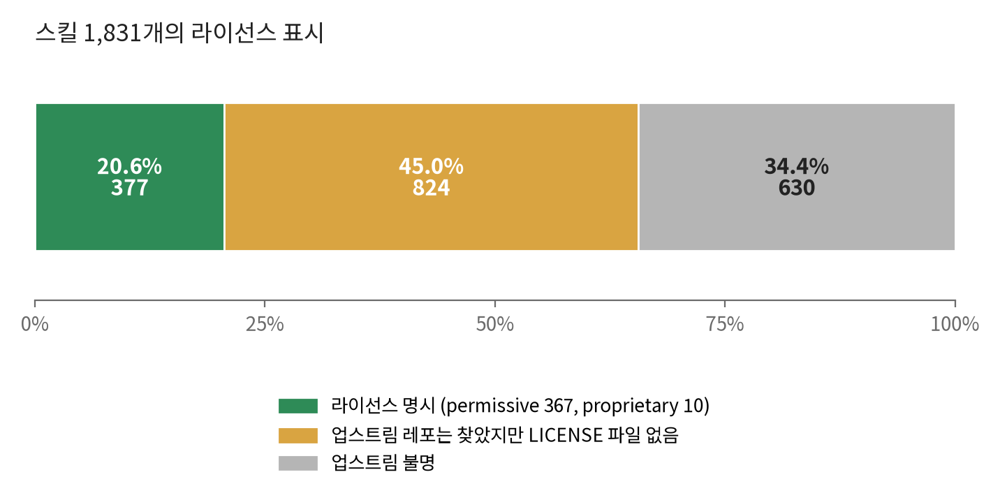

# 공개 AI 에이전트 스킬 1,800개를 검증해봤다

*2026-10-22 · Kwan Hyeon*

**한눈에 보기**

- **라이선스**: 다섯 중 하나만 라이선스를 밝힌다(20.6%).
- **충돌**: 스킬끼리 정면으로 모순되는 경우는 드물다. 두 스킬이 갈릴 때 승자를 지정해도 지정한 스킬을 따른 실행은 43–56%다.
- **효과**: 측정한 태스크 종류 5개 중 스킬이 결과를 바꾼 건 디자인 1개다.
- **라우터**: 사소하지 않은 태스크에서 57세션 중 55에서 발화하고, 관련 스킬이 있는 태스크의 93%에서 그중 하나 이상을 top 50에 넣는다.

SKILL.md는 새 npm이다. 코딩 에이전트에 스킬 서른 개를 깔고 한 개도 안 읽어본다. 공개 스킬 1,831개를 가져와 린트하고, 프롬프트 인젝션 패턴을 스캔하고, 안에 든 지시 29,880개를 뽑아내서 서로 모순되는 게 없는지 확인했다. 그리고 그게 실제로 뭘 바꾸는지 보려고 에이전트 세션 1,708개를 돌렸다. 네 가지가 나왔다. 다섯 중 하나만 라이선스를 밝힌다. 규칙은 스킬 간 정면 충돌을 거의 찾지 못했다. 규칙이 낸 하드 판정 2개는 둘 다 오탐이었고, 얼마나 놓치는지는 재지 않았다. 두 스킬이 갈릴 때 에이전트는 한 태스크에서는 대개 같은 쪽을 고르는데, 승자를 알려주는 세 방법 중 어느 것도 믿을 만한 통제가 아니었다. 지정한 스킬을 따른 실행은 43–56%였고, 가장 나은 방법도 에이전트가 원래 고르던 쪽을 그런 쪽이 있던 23쌍 중 8쌍에서만 뒤집었다. 그리고 스킬이 결과를 바꾼 건 측정한 태스크 종류 5개 중 1개뿐이다. 디자인에서는 전문가 스킬이 템플릿 티를 없앴다. 테스트·API·문서·데이터 스크립트에서는 스킬이 있든 없든 모든 체크를 통과했다. 관련 스킬이 있는 벤치마크 태스크 284개 중 93%에서 라우터의 검색은 그중 하나 이상을 top 50에 넣는다. 실제 레포에서 라우터는 사소하지 않은 태스크의 68%(39/57)에서 발화했다. description 한 줄을 고치자 96%(55/57)가 됐고, 사소한 태스크에서는 30회 중 1회만 발화했다.

## 무엇을 했나

소스는 둘이다. Anthropic의 [공식 스킬 레포](https://github.com/anthropics/skills) 19개와, 업스트림 레포 11곳에서 모은 1,812개짜리 집계본 [Universal AI Skills Library](https://github.com/onfire7777/universal-ai-skills-library). 모든 스킬이 같은 파이프라인을 탔다.

1. **린트**: frontmatter 파싱, name·description 존재, 깨진 상대 링크 없음.
2. **인젝션 스캔**: 지시 덮어쓰기, 자격증명 읽기, 권한 상승, 숨은 텍스트에 대한 정규식 블록리스트. 안전 증명이 아니라 블록리스트다.
3. **제약 추출**: LLM이 SKILL.md를 읽고 실행 가능한 지시 하나하나를 타입 있는 레코드로 바꾼다. subject, directive(require / forbid / prefer / avoid), object, scope, 그리고 원문 줄. 인용할 줄이 없는 제약은 버린다.
4. **쌍 비교**: 같은 subject에 반대 극성, scope가 겹치면 충돌 후보. 텍스트만으로 못 정하면 `conflict`가 아니라 `needs_review`.
5. **LLM judge**: 열린 쌍을 추출기와 다른 벤더의 모델이 원문 줄로 다시 읽는다.
6. **복종 테스트**: judge가 진짜 충돌이라 한 쌍은 두 스킬을 에이전트에 같이 넣고 그 규칙이 걸리는 태스크를 줘서 어느 쪽을 따르는지 기록한다.

Claude Code 구독료를 빼면 실제로 쓴 돈은 외부 API **$15.75**뿐이다. 추출 $6.23(gpt-6-luna, 픽스처로 시험한 네 모델 중 가장 싼 모델), judge $9.36(claude-sonnet-5.5), 태스크 생성 $0.16이다. 에이전트 세션 1,708개와 벤치마크 배치 호출은 그 구독으로 돌렸다. 같은 토큰을 API 단가로 치면 약 $650이고([numbers.md](numbers.md) §7), 처음부터 재현하는 데 드는 비용이 대략 이 정도다. 코드를 쓰고 출력을 분류한 대화형 세션과 사람의 시간은 이 값에 들어 있지 않다. 복종 테스트와 분류는 Claude Code 세션 안에서 돌렸다. 저자에 대해 한 줄: 파이프라인 설계와 판단은 내가 했고, 코드의 대부분과 실험 실행은 Claude Code가 했다. 이 글에서 "내가 읽었다"는 사람이 읽었다는 뜻이다. 코드와 숫자: [hyunlord/skillfetch](https://github.com/hyunlord/skillfetch).

## 1. 다섯 중 하나만 라이선스를 밝힌다

1,831개 중 377개(20.6%)만 자기 폴더나 복사해 온 업스트림 레포에 라이선스가 있다. 나머지는 아무 표시가 없다. 저작권법에서 표시 없음은 모든 권리 보유다. GitHub에서 읽을 수는 있지만, 인덱스에 담아 재배포할 수는 없다.



"업스트림은 있는데 라이선스 없음" 824개 중 822개가 `ComposioHQ/awesome-claude-skills` 한 곳에서 왔다. 레포 레벨 LICENSE가 없다. 이걸 다시 모은 라이브러리는 MIT지만, 집계 레포의 MIT 딱지가 다른 곳에서 복사한 파일에 라이선스를 부여하지는 못한다. 특정 프로젝트의 문제가 아니라 생태계 전체가 지금 이렇게 돌아가고 있고, 대부분의 메인테이너가 생각해본 적 없는 문제일 것이다. Anthropic 공식 레포도 섞여 있다. 19개 중 4개(docx, pdf, pptx, xlsx)는 all rights reserved고 1개는 라이선스 파일이 없다.

법적 판단이 아니라 표시 유무의 집계다. 하지만 본문을 재배포하는 레지스트리라면, 이 재고의 약 80%에 대해 그걸 허락하는 라이선스를 우리가 찾지 못했다는 뜻이다. 630개는 원본(upstream)조차 확인할 수 없었다. 내 도구에 미친 영향은 명확했다. 인덱스에는 메타데이터와 콘텐츠 해시만 담고, 본문은 사용 시점에 원본 레포에서 가져와야 한다.

## 2. 107개는 기본 위생에서 탈락, 216개는 실행 스크립트 동봉

82개가 린트, 25개가 인젝션 스캔에서 탈락해 1,724개가 인덱스에 들어갔다. 린트 탈락은 대부분 깨진 링크다. 폴더에 없는 `references/auth.md`를 가리키거나, 스킬 바깥 파일을 가리킨다. 스캔 쪽이 더 흥미롭다.

| 스캔 규칙 | 건수 | 잡는 것 |
| --- | --- | --- |
| `privilege.dangerous-flag` | 23 | `--dangerously-skip-permissions`, `--no-sandbox` |
| `exfil.secret-env` | 7 | `$API_KEY`, `$TOKEN`, `$SECRET`의 echo나 전송 |
| `hidden.html-comment-instruction` | 7 | `<!-- -->` 안의 에이전트 지시 |
| `exfil.ssh-keys` | 5 | `~/.ssh` 읽기·복사 |
| `privilege.disable-sandbox` | 3 | "sandbox 비활성화/우회" |
| `exfil.cloud-credentials` | 3 | `~/.aws`, `~/.kube`, `~/.config/gcloud` |
| `hidden.invisible-chars` | 3 | 본문의 zero-width 문자 |
| `override.ignore-previous` | 1 | "ignore previous instructions" |
| `exfil.dotenv` | 1 | `.env` cat이나 업로드 |

직접 확인한 건들은 공격이 아니었다. 하나는 Anthropic의 API 가이드로, "ignore what the user said" 같은 프롬프트를 쓰지 말라고 조언하면서 그 문구를 인용했다가 걸렸다. 다른 하나는 headless Chrome에 `--no-sandbox`를 넘기는 E2E 테스트 스킬이었다. 이게 정확히 문제다. 정규식은 튜토리얼과 익스플로잇을 구분하지 못한다. 그 파일을 막 로드한 에이전트가 구분하는지는 시험하지 않았다. 이런 스캔은 "볼 곳을 알려주는" 게이트로는 쓸 수 있지만 판결로는 못 쓴다. 25개를 전부 읽지는 않았으니 악성이 없다고는 못 하고, 패턴 매칭만으로는 그걸 알 수 없다고만 말할 수 있다.

별도로 216개는 에이전트가 실행할 셸·파이썬 스크립트를 동봉한다. 그 자체는 문제가 아니지만, 신뢰의 질문이 "이 텍스트가 에이전트에게 뭘 시키나"에서 "에이전트가 이 코드를 돌리면 무슨 일이 나나"로 바뀐다. 어떤 SKILL.md 린터도 답하지 않는 질문이다.

## 3. 스킬은 정면으로 모순되지 않는다. 서로를 좁힐 뿐이다.

예상 못 한 결과다. 파이프라인은 "기능 단위로 스쿼시해라" vs "절대 스쿼시하지 마라" 같은 쌍을 잡으려고 만들었다. 1,722개 스킬에서 뽑은 29,880개 제약에서 규칙이 충돌로 판정한 건 **2쌍**. 둘 다 읽었고, 둘 다 오탐이다.

```
CONFLICT  darwin ⟷ thinking-ooda
  darwin:37          "**Principles:** Observe before acting · …"
  thinking-ooda:108  "Immediately return to OBSERVE"
```

이건 OODA 루프지 모순이 아니다. 다른 하나는 caveman-review:51 "Drop terse mode for: security findings (CVE-class bugs need full explanation + reference) …"와 saga의 autorun 모드에 적용되는 saga:394 "Skip verbose explanations, focus on deliverables"의 쌍이다. 상황이 다르다. 그러니 규칙의 하드 판정 2개 중 진짜 모순은 없다. 그렇다고 모순이 없다는 뜻은 아니다. 재현율은 재지 않았고, 기본 모드는 전면 규칙을 일부러 낮추며, 아래 judge는 90쌍을 conflict라 한다.

규칙이 대신 찾은 건 판정 못 한 쌍 2,011개다. tension 137, `needs_review` 1,874. 이 전부를 다른 모델이 원문 줄로 다시 읽게 했다.


규칙에 수상해 보였던 쌍 다섯 중 넷은 문제없다. judge가 conflict라 한 90개도 대부분 "항상 물어보고 해라" vs "팀이 정해지면 다시 묻지 마라" 형태다. 한 규칙이 다른 규칙에 예외를 파는 것. judge는 이걸 과대 판정하는 경향이 있다. 손 라벨 세트에서 알려진 carve-out 7개 중 6개를 conflict라 했으니 90개 중 일부는 진짜 충돌이 아니다. judge가 independent라 한 쌍은 감사하지 않았으니, 90이 코퍼스 전체 충돌의 상한인 것도 아니다.

전체를 관통하는 패턴: 스킬 작성자들은 **무엇을** 할지를 다투지 않는다. **언제**와 **얼마나**를 다투어야 한다고 쓰고 있다. 풀어 말하면 응답은 짧게 vs 보안 발견은 철저히, 중요한 단계는 전부 로깅 vs 테스트 코드 안에서는 로깅 금지 같은 것들이다. 스킬의 버그가 아니다. 에이전트가 알아서 조율해야 하는 종류의 것이고, 질문은 실제로 그렇게 하나다.

## 4. 두 스킬이 갈릴 때 에이전트는 동전을 거의 던지지 않는다. 한 태스크에서는 대개 같은 쪽을 고른다.

judge가 conflict이면서 "함께 따르기 어렵다"고 본 쌍 26개를 골랐다. 쌍마다 다투는 규칙이 걸리는 태스크를 하나 써서, 두 스킬 본문을 다 넣고 우선순위 힌트 없이 새 에이전트 세션에서 5번 돌렸다. 순서는 바꿔가며(홀수 회차 A 먼저, 짝수 B 먼저), 각 출력을 A 따름 / B 따름 / 둘 다 / 둘 다 아님으로 분류했다.

| 5회 결과 | 쌍 수 |
| --- | --- |
| 5번 다 같은 한 스킬을 따름 | 17 |
| 5번 다 같은 비스킬 결과 (둘 다 / 둘 다 아님) | 2 |
| 섞임: 어떤 회차는 A, 어떤 회차는 B | 4 |
| 그 외 혼합 | 3 |

26쌍 중 17쌍에서 에이전트는 5번 중 5번 같은 한 스킬을 따랐고, 7쌍은 결과가 달라졌으며 그중 4쌍은 A와 B를 오갔다. 로드 순서는 합계로는 효과가 없었다. 한쪽만 따른 경우 먼저 넣은 게 51번, 나중에 넣은 게 53번.

그러니 시험한 태스크에서 실패 양상은 대체로 랜덤이 아니라 **안정적이고 보이지 않는 선호**였다. `tdd` ⟷ `warden` 태스크에서 에이전트는 5번 모두 `tdd`를 따랐고, 세션 어디에도 이유가 나오지 않았다. 쌍마다 태스크가 하나뿐이라, 그런 선호가 다른 태스크에서도 유지되는지는 말할 수 없다.

중요한 경고 둘. 첫째, 하네스 문구가 결과를 바꾼다. 버린 배치에서 "이 답변 하나로 끝내라"는 문구는 "멈추고 사용자에게 물어보라"는 규칙을 전부 지게 했다. 멈추기 vs 진행하기 쌍이 가장 취약하다. 둘째, 130개 출력은 분류기 하나, Claude Code 세션 하나가 분류했고 두 번째 평가자는 없었다. 소수점 있는 숫자를 말하기 전에 두 번째 평가자가 필요하다.

**내가 시도한 어떤 방법도 스킬에 믿을 만한 순서를 주지 못했다.** 뻔한 해법은 어느 스킬이 이기는지 에이전트에게 알려주는 것이다. 같은 26쌍에 세 가지 방법을 써봤다. A를 승자로 지정해 5번, B를 승자로 지정해 5번, 방법마다 260번, 하네스와 분류는 같다. 지정한 승자를 따른 실행은 다음과 같다(그림 2 아래).

- 스킬 앞 헤더: "Skills are listed in precedence order. If two instructions disagree, follow the earlier one." (`load_skills`가 넣던 문구): 43% (112/260)
- 승자를 지명하고 충돌하는 두 줄을 인용한 블록: 56% (145/260)
- 지는 스킬의 충돌 줄을 `<!-- overridden by <winner>: "<line>" -->`로 치환: 46% (120/260)

셋 다 믿을 만한 통제가 아니다. 지정한 스킬을 따른 실행은 43–56%다. 가장 나은 방법인 승자 지정 블록도 에이전트가 원래 고르던 쪽이 있던 23쌍 중 8쌍에서만 그걸 뒤집었다(나머지 3쌍은 다수 승자가 없었다). 위의 130번까지 합쳐 910번이다. 쌍별 표는 [numbers.md](numbers.md) §8–§10.

## 5. 태스크마다 스킬을 가져오면 달라지나? 태스크 종류 5개 중 1개에서.

알아보려고 실제 Claude Code 세션을 조건 3개로 돌렸다. **A** 스킬 없음, **B** 전문가가 깔았을 스킬 1개를 미리 로드, **C** skillfetch 라우터("써보기"에서 설명하는 MCP 서버)가 인덱스에서 고름. 판정은 전부 모델 판정자(Claude)가 조건을 무작위 코드로 가린 채 블라인드로 했다. 1단계는 테스트를 돌린 세션이, 1b 재판정과 2단계는 루브릭과 출력만 본 새 하위 에이전트가 판정했다.

레포 2개(FastAPI 템플릿, Next.js 스타터)의 작은 유지보수 태스크 20개(404 페이지, 페이지네이션 링크, README 표)를 조건마다 2회씩 돌린 1단계(B는 전문가 스킬이 있는 15개만)에서는 세 조건이 구별되지 않았다. 숨긴 체크 110/110 통과, 스크린샷 동순위, 문서 동순위. 이 작은 태스크들에서는 체크나 판정자가 볼 수 있는 차이를 스킬이 만들지 않았다. C는 그 대가로 전문가 스킬이 있는 15개 태스크에서 A보다 6.5턴(20개 전체로는 6턴), 입력 토큰은 59%를 더 썼다.

같은 레포 2개의 큰 태스크 5개를 조건마다 2회씩 돌린 1b 단계에서는 갈렸다. 이게 일반화되는지 보려고 다른 도메인 4개에서, 도메인마다 별도 레포로 큰 태스크를 하나씩 더 돌렸다(2단계): 테스트가 없는 280줄 모듈의 테스트 작성, FastAPI 북마크 API, 문서 없는 Next.js 앱의 README, 문제 10종을 심은 375행 주문 CSV를 정리하는 스크립트. 조건마다 5회, 체크는 실행 전에 동결, 출력마다 새 모델 판정자의 블라인드 판정 2회. 2단계는 아래에서 설명하는 검색 수정 후 라우터만 썼다.


*2단계 각주 두 개.* (a) 문서화: C2 run 2개가 C2 레포에만 있던 라우터 설치 파일(`.mcp.json`, `.claude/`)을 README에 적었고, 첫 번째 판정이 감점 이유로 그걸 들었다. 라우터의 약점이 아니라 하네스의 흔적이다. 이를 감안하면 문서화도 조건 간 차이가 없는 쪽에 가깝다. (b) 하네스는 세션에 AskUserQuestion이나 plan mode 도구를 주지 않았다. 그래서 라우터가 대화형 스킬(인터뷰·승인 단계가 있는 것)을 골랐을 때 실제 세션에서 멈추는지는 이 실험으로 관측할 수 없다. 백엔드 API run 1이 그런 경우다. "Enter plan mode", "Use AskUserQuestion to clarify requirements"라고 적힌 `fastapi-endpoint`를 로드하고도 "Requirements are clear enough to implement directly."라며 바로 구현했다.

전문가의 스킬은 효과가 있다. Anthropic의 `frontend-design`을 로드하면 랜딩 페이지에서 템플릿 티가 사라진다("AI 템플릿" 표식 2.00 → 0.50, 검색 수정 후 라우터도 0.50). 라우터 첫 버전은 그 스킬을 한 번도 못 찾았고(13위~41위, 검색이 돌려준 10개 안에는 한 번도 없었다), 대신 디자인 근처의 다른 스킬을 로드했다. 랜딩 페이지에서는 그 스킬들이 템플릿 표식을 줄이지 못했고(2.00, 스킬 없음과 같음), 플랜 태스크에서는 스킬 없을 때보다 나쁜 플랜을 만들었다(순위 0.79 vs 0.36, 0 = 최상). 거기서는 엉뚱한 스킬을 로드하는 게 안 하느니만 못했다.

검색을 압축 요약 50개로 넓히고 에이전트가 거기서 고르게 하자, 도메인 이름이 있는 이 태스크들에서는 전문가 스킬이 매번 라우터의 top 50에 들었다.

| 태스크 종류 | 전문가 스킬 | 라우터 top 50에 포함 | 그 안의 평균 순위 | 로드 |
|---|---|---|---|---|
| 랜딩 페이지 (1b) | `frontend-design` | 4/4 | 29.2 | 4/4 |
| 테스트 작성 | `python-testing-patterns` | 5/5 | 1.0 | 5/5 |
| 백엔드 API | `fastapi-templates` | 5/5 | 2.0 | 4/5 |
| 문서화 | `quill` | 5/5 | 1.8 | 5/5 |
| 데이터 스크립트 | `data-analyst-engine` | 5/5 | 2.0 | 5/5 |
| 전체 | | 24/24 | | 23/24 |

스킬을 찾는 것과 스킬이 필요한 것은 다르다. 전문가 스킬이 결과를 바꾸는 걸 본 도메인은 디자인 하나뿐이다. 테스트·API·문서·데이터 스크립트에서는 세 조건 모두 객관 지표가 만점이었고(branch 커버리지 100%, 계약 호출 27/27, 체크 전부 통과), 조건 간 점수 차이(0.6 이하)는 두 번의 판정 사이 차이에 비해 작다. 두 판정은 출력 15개 중 8~14개에서만 점수가 같았다. 도메인당 태스크 1개, 조건당 5회라 이것으로 효과가 있다고도, 없다고도 할 수 없다. 라우터는 스킬 없을 때보다 입력 토큰을 1.7~2.1배, 턴을 6~8개 더 쓴다. 이 결과의 범위는 여기까지다: 스킬 없이 중앙 9~15턴에 끝나는 태스크, 모델 1종, 조건당 5회.

라우터는 여전히 *어떻게* 일할지에 관한 스킬을 못 찾는다. 전문가의 `writing-plans` 스킬은 일하는 방식을 설명하고 태스크는 기능을 설명하니, 키워드 검색으로는 그 사이를 못 건넌다. 22M 파라미터 임베딩 모델도 못 건넜다(BM25와 합친 top-50 리콜 0.74 vs BM25 0.71, [numbers.md](numbers.md) §12). 그래서 제품에 안 넣었다.

## 6. 맞는 스킬을 얼마나 찾나? 태스크 380개 벤치마크.

태스크 종류 5개는 표본이 작다. 그래서 더 큰 오프라인 벤치마크를 만들었다. 합성 개발 요청 380개로, 300개는 태스크 종류 12 × 스택 6 × 표현 5의 조합 360개 중 300개에 하나씩 넣었고, 40개는 아무것도 로드하지 말아야 할 사소한 요청, 20쌍은 일하는 방식만 다른 요청이다. 태스크마다 모델이 후보 스킬을 0–3점으로 채점했고, 2점 이상이 관련 세트다. 채점한 모델(Opus 5.5)이 라우터를 돌리는 모델과 같으니, 이 라벨은 정답이 아니라 일관성을 잰다. 두 번 채점하면 500쌍 중 94%가 같은 점수였다. 다른 모델(GPT Astra)이 120개 태스크를 다시 채점했더니 범용 프로세스 스킬을 훨씬 자주 관련으로 봤다(관련 여부 κ 0.48). 하지만 두 모델이 모두 관련으로 본 라벨에서는 방법 간 순위가 그대로였다. 태스크·라벨·쿼리·채점기는 레포에 있다(`evals/retrieval/`, `skillfetch eval retrieval`).

라우터는 세 단계를 거친다. 태스크를 받으면 skillfetch를 부를지 정하고(발화), 태스크를 재진술해 검색하고, 검색이 돌려준 top 50에서 고른다. 아래는 이 순서로 본 결과다. 그림 4는 단계마다 이전 버전과 지금 버전을 나란히 놓는다.


### 발화

실제 레포 두 개에서 실제 세션을 돌렸다(4단계). 벤치마크 태스크 중 29개를 레포에 맞게 고쳐 쓰고, 두 환경에서 각 3회씩: 깨끗한 환경(skillfetch만)과 내 환경(MCP 서버 14개, 스킬 134개, 모든 도구 호출에 걸린 훅). 사소하지 않은 태스크에서 라우터는 깨끗한 환경에서 57세션 중 23, 내 환경에서 57세션 중 22에서 발화했고, 이 19개 태스크에서 태스크별 차이의 평균은 +0.018이었다(사소한 태스크까지 포함한 29개 전체로는 0.000). 실제 레포에서 라우터는 사소하지 않은 태스크의 40%에서 발화했고, 이 표본에서는 내 설정을 걷어내도 그 비율이 오르지 않았다. 건너뛰라고 한 사소한 태스크에서는 30세션 중 0과 1. 앞서 스텁 레포에서 돌린 실행(3단계)은 40세션 중 12에서 검색까지 갔는데, 실제 코드가 없는 환경이라 그 숫자는 스텁의 한계이지 발화율이 아니다.

무엇이 라우터를 발화시키는지 보려고 한 번 더 돌렸다(5단계). 사소하지 않은 태스크 19개를 깨끗한 환경에서 다시 세 번씩 돌렸고, 그중 9개는 레포에 실제로 있는 코드를 가리키도록 다시 썼다. 변형마다 배포된 라우터에서 하나만 바꿨다. 변형별 발화 / 스킬 로드 / 세션 비용 평균:

- V0, 당시 배포된 라우터: 39/57, 35/57, $0.396
- V1, description이 첫 도구 호출 전(git status, Read, Grep, Glob, ls 전)에 돌라고 말함: 55/57, 50/57, $0.455
- V2, V0 + 프로젝트 CLAUDE.md 한 줄: 57/57, 55/57, $0.533
- V3, V0 + 더 강한 MCP 서버 instructions: 36/57, 31/57, $0.384

V1과 V2는 각각 태스크 19개 중 9개에서 발화를 늘렸고 줄인 태스크는 없었다(부호 검정 p 0.004). MCP 서버 instructions는 도움이 되지 않았다. V3는 36세션에서 발화했는데, 그중 19세션은 라우터를 거치지 않고 도구를 바로 불렀다. 이제 라우터의 description은 V1이다. 사소한 태스크 10개에서는 30회 중 1회 발화했다(V0는 30회 중 0회). V2는 직접 관리하는 레포에서 쓸 수 있는 선택지이고, 예전 description과 함께만 쟀다.

### 검색

관련 스킬 중 top 10과 top 50에 든 비율:

| search_skills에 넣은 것 | top 10 | top 50 | 프로세스 스킬, top 50 |
|---|---|---|---|
| 사용자가 쓴 요청 그대로 | 0.387 | 0.683 | 0.632 |
| 라우터의 한 문장 재진술 | 0.483 | 0.775 | 0.727 |
| 세 문장(무엇을 만드나, 어떻게 일하나, 스택)을 각각 검색해 병합 | 0.535 | 0.835 | 0.783 |
| 한 문장, BM25와 MiniLM 임베딩 융합 | 0.473 | 0.801 | 0.734 |

재진술을 세 문장으로 나누면 한 문장이 놓친 것 대부분을 되찾고, 프로세스 스킬도 마찬가지다. 처음 배포한 라우터는 사용자가 일하는 방식을 말했을 때만 그 문장을 썼다. 지금은 항상 세 문장을 다 쓰고, 사용자 요청 원문을 네 번째 쿼리로 더한다. 위의 4단계는 이전 버전을 실제 세션으로 돌린 것이고, 한 쿼리 버전과 비교하지는 않았고 작업 결과도 채점하지 않았다. 임베딩 모델은 같은 한 문장에서 top 50을 0.026 올렸고, 채택 기준 0.10에 못 미쳐 넣지 않는다.

질문을 하나가 아니라 셋으로 나누자 라벨된 관련 스킬이 있는 태스크 278개에서 top-50 recall이 0.835가 됐다. 배포된 라우터는 top-50 recall 0.81이고, 이번 수정 전에는 0.74였다. 관련 스킬을 하나 이상 top 50에 넣은 태스크는 93%다(수정 전 89%). 0.81, 0.74, 93%, 89%는 라우터 쿼리가 찾은 스킬까지 라벨을 넓힌 기준이다(태스크 284개).

라벨 기준이 다른 값([numbers.md](numbers.md) §13): 세 문장 검색은 카탈로그로 고른 부분집합 기준 0.764, 배포된 라우터는 검색이 치우치게 할 수 없는 라벨 기준 top-50 recall 0.75, 관련 스킬을 하나 이상 top 50에 넣은 태스크 81%(태스크 209개).

찾을 게 아예 없는 태스크도 있다. 사소하지 않은 태스크 340개 중 62개는 인덱스에 관련 스킬이 없고, ml(29개 중 11), deploy(29개 중 9), feature와 performance(각 8), data와 ui_design(각 7)에 몰려 있다.

### 선택

무너지는 건 선택이다. 실제 top 50을 주면, 관련 스킬이 있는 태스크의 82%에서 하나 이상을 골랐다(precision 0.81, recall 0.42). 그런데 인덱스에 맞는 게 없는 태스크 95개 중 30개에서 뭔가를 로드했고, 사소한 요청 40개 중 30%에도 스킬을 로드했다. 실패를 태스크 단위로 세면 선택 55개(목록에 있던 관련 스킬을 안 고른 것 25, 맞는 게 없는데 로드한 것 30), 재진술 20개, 검색 7개다.

4단계에서 뭔가를 로드했을 때 관련 스킬이 든 건 14세션 중 8, 17세션 중 10이었다. 5단계에서 관련 스킬이 있는 태스크에서 라우터가 세트를 로드했을 때 관련 스킬이 든 세션은 V0 32개 중 26개, V1 45개 중 35개였다. 작업 자체가 나아졌는지는 재지 않았다. 인덱스에 맞는 스킬이 없을 때도 라우터는 뭔가를 로드한다. 오프라인 벤치마크에서는 그런 태스크 95개 중 30개, 4단계에서는 환경마다 24세션 중 4세션이었고, 5단계에서는 그런 태스크 2개에서 검색한 세션 중 하나를 뺀 전부였다.

이 글의 숫자를 동결한 뒤 선택 단계에 문장 하나("Do not pick a skill unless you can say in one sentence what its summary changes in this task", 이 스킬의 요약이 이 태스크에서 무엇을 바꾸는지 한 문장으로 말할 수 없으면 고르지 말 것)를 더했다. 그러자 오프라인에서 아무것도 고르지 않아야 할 때 고르지 않은 비율이 0.55에서 0.85로 올랐고, 관련 스킬을 하나 이상 고른 태스크 비율은 0.88에서 0.80으로 내려갔다. 판정 규칙을 미리 고정한 실행에서는 디자인 태스크 점수는 판정 간 차이 안에 머물렀고, 나머지 태스크의 턴과 토큰을 줄였으며, 맞는 스킬이 없는 태스크에서는 아무것도 로드하지 않았다(9세션 중 0, 이전 규칙은 5). 지금 배포된 규칙이다([numbers.md](numbers.md) §17).

## 도구가 틀리는 것

파이프라인은 정밀도를 재현율보다 우선하도록 튜닝되었고, 그 비용이 숫자에 보인다.

- **재현율은 측정되지 않았다.** 공개 스킬 1,700개를 충돌 기준으로 손 라벨한 사람은 없다. 충돌 정밀도를 아는 건 픽스처(1.0)뿐이다. 공개 스킬에서는 하드 판정 2개가 둘 다 오탐이라 정밀도를 추정하기엔 너무 적고, 얼마나 놓치는지는 모른다. 기본 모드는 object가 없는 전면 규칙("이모지 금지")을 일부러 `needs_review`로 내린다. 실제 스킬에서 모든 오탐이 거기서 나왔기 때문이다. 내 손 라벨 테스트 세트에서는 그게 진짜 충돌 19개 중 8개를 숨긴다.
- **judge는 한쪽으로 기울어진다.** 알려진 carve-out 7개 중 6개를 conflict라 했으니 90개 중 일부는 충돌이 아니다. independent라 한 쌍은 감사하지 않았으니 90은 상한도 아니다.
- **추출 프롬프트 6버전, 테스트 세트 하나.** 당시 손으로 쓴 픽스처 스킬 41개에 맞춰 추출 스키마를 여섯 번 고쳤고, 거기서 충돌 정밀도 1.0, informative-pair 정확도 0.912가 나왔다(픽스처 디렉터리는 지금 52개: 손으로 쓴 44개와 실제 공개 스킬 줄을 그대로 둔 cap 픽스처 8개). 그 다음 공개 스킬 26개의 holdout에서 추출 v4는 충돌 24개를 냈고 전부 오탐이었다. 최종 버전은 거기서 0개, 전체 빌드에서 2개를 낸다. 이후 버전은 그 24개를 본 뒤에 만들었으니 그 holdout은 더 이상 독립적이지 않고, 0개라는 결과는 재현율에 대해 아무것도 말하지 않는다. 튜닝한 세트에서 만점은 holdout이 동의하기 전까지 아무 의미가 없다.
- **오탐 2개가 산출물에 그대로 들어 있다.** 고치는 대신 README에 그렇다고 적었다.
- **anti-pattern 테이블이 추출기를 속인다.** "❌ Don't" 테이블의 행이 지시로 읽힌다. 이슈로 열려 있다.
- **추출은 의미 작업이라 모델이 필요하다.** gpt-6-luna로 스킬당 약 $0.003(최종 실행 $4.82: 요청 1,764개, 공개 스킬 1,723개와 픽스처 41개).
- **대화형 스킬은 검증되지 않았다.** 엔드투엔드 하네스는 세션에 AskUserQuestion이나 plan mode 도구를 주지 않았다. 그래서 라우터가 인터뷰·승인 단계가 있는 스킬을 골랐을 때 실제 세션이 멈추는지는 관측하지 못했다(5절 각주 b).

## 써보기, 그리고 다음

스캐너는 로컬 스킬 디렉터리 어디에나 돌아가고, 모든 판정에 원인이 된 원문 줄 두 개를 같이 찍는다. 공개 스킬의 사본은 공개 인덱스에서 바로 분석되므로 모델이나 API 키가 필요 없다.

```
uvx --from git+https://github.com/hyunlord/skillfetch skillfetch sync
uvx --from git+https://github.com/hyunlord/skillfetch skillfetch scan ~/.claude/skills
uvx --from git+https://github.com/hyunlord/skillfetch skillfetch scan ~/.claude/skills --fail-on conflict   # CI용
```

원래 만들려던 건 나머지 반이다. 스킬의 80%에 대해 재배포를 허락하는 라이선스를 찾지 못했고, 대부분은 같이 써도 괜찮고, 안 괜찮은 것들은 조용한 우선순위로 해소된다는 걸 알고 나니, 원하는 건 **스킬을 아예 설치하지 않는** 에이전트다. 태스크마다 검증된 인덱스를 검색해 작은 세트를 골라서, 위의 긴장 관계를 검사하고, 본문은 원본 레포에서 해시 검증해 가져오고, 태스크가 끝나면 버린다. 그 MCP 서버의 초기 버전이 레포에 있다. `search_skills`, `resolve_set`, `load_skills`, Claude Code에서 엔드투엔드로 동작한다. 스킬은 지금 컨텍스트에 로드되고 다음 태스크에서 내려가지 않는다. 태스크별 격리는 만들지 않았고, 충돌 검사는 최선의 노력이지 보장이 아니다. 인덱스에는 메타데이터·제약·해시만 있고 본문은 없다. 5절은 그걸 실제로 돌려본 결과다.

관련 작업: [UASL](https://github.com/onfire7777/universal-ai-skills-library)과 skill-search는 태스크에 스킬 하나나 목록을 준다. [Skillselion](https://skillselion.com)은 MCP 서버로, 자기 카탈로그를 검색해 스킬의 SKILL.md와 파일을 설치 없이 작업 중에 불러오고, skills.sh 설치 수로 순위를 매긴다. 문서에는 스킬 스캔, 충돌 검사, 로드가 도움이 되는지 측정하는 이야기가 없다.

스킬을 관리한다면 LICENSE 파일을 넣어라. 레지스트리를 관리한다면 그걸 보여줘라. 서로 안 맞는 것 같은 스킬 한 쌍이 있으면 스캐너를 돌려서 결과를 이슈로 열어줘라. 뭐를 잡는지보다 뭐를 놓치는지가 더 알고 싶다.

## 출처와 데이터

- 코드, 설계 문서, 숫자별 재현 명령이 든 부록: [hyunlord/skillfetch](https://github.com/hyunlord/skillfetch), `docs/writeup/numbers.md`
- 코퍼스: [anthropics/skills](https://github.com/anthropics/skills) `dbd4588f`; [onfire7777/universal-ai-skills-library](https://github.com/onfire7777/universal-ai-skills-library) `2a76bf42`
- 스킬 형식: [Agent Skills specification](https://github.com/anthropics/skills/tree/main/spec)
- 대규모 스킬 검색 관련 연구: [SkillRouter](https://arxiv.org/abs/2603.22455), [Compositional Skill Routing](https://papers.cool/arxiv/2606.18051). 둘 다 검색된 스킬들이 서로 맞는지는 다루지 않는다. 이 글이 보는 게 그 빈자리다.

모든 숫자는 2026-10-22 기준. 코퍼스는 매일 바뀐다. 재빌드 후 `scripts/write_numbers.py`를 다시 돌리면 된다.
