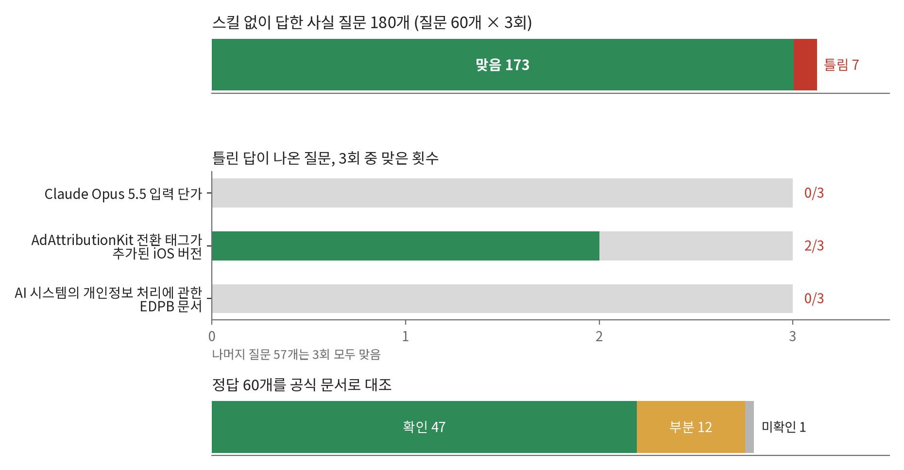
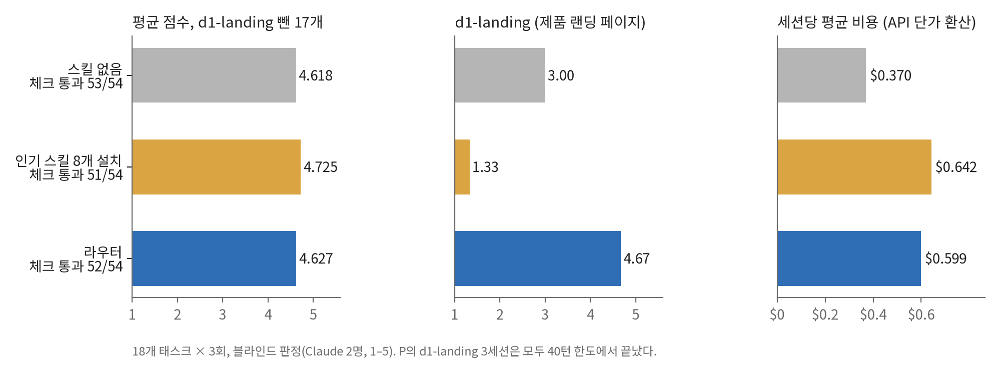
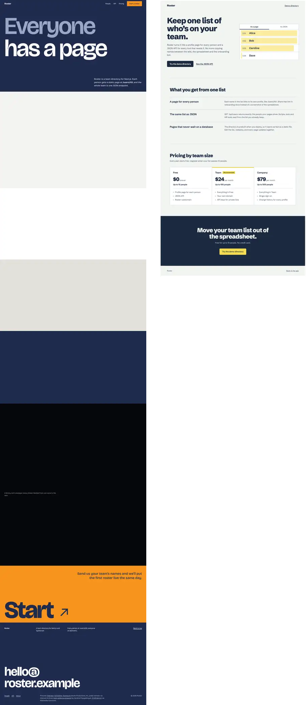

# 에이전트 스킬은 읽지 않고 설치된다. 그래서 무엇이 바뀌는지 재 봤다

*2026-10-28 · Kwan Hyeon*

**한눈에**

- **안전**: 공개 index의 중복 없는 스킬 2,281개의 `SKILL.md`를 모델이 고정된 체크리스트로 읽게 했다. 9개가 표시됐고, 내가 판정하니 6개가 실제 위험, 2개가 경미, 1개가 오탐이었다. 공격은 없었다. 여섯 개 모두 사용자의 스킬을 전부 지우거나 바뀔 수 있는 브랜치의 규칙을 받아 따르는 식의 부주의한 설계였다. 규칙 기반 점검은 그 6개 중 3개를 RECOMMENDED로 통과시켰다([numbers.md](numbers.md) §32).
- **지식**: 모델이 모를 수 있는 지식을 내세운 스킬 30개에서 사실 60개를 뽑아 물었더니, 스킬 없이 180번 중 173번 맞혔다. 한 스킬은 내가 찾지 못한 지침을 인용한다([numbers.md](numbers.md) §24).
- **효과**: 알아서 쓰게 둔 인기 스킬은 결과를 거의 바꾸지 않았다. 8개를 깔아도 결과는 스킬 없을 때와 같았다. 예외는 디자인 태스크 하나로, 큰 디자인 스킬을 읽다가 턴 한도에 걸렸다. 태스크별 라우터는 스킬 없음과 같은 결과를 62% 더 비싸게 냈다([numbers.md](numbers.md) §26).
- **스킬이 돕는 곳**: 팀이 적어 두었지만 코드에는 드러나지 않는 규칙. 맞는 스킬을 주면 규칙 체크 통과가 0.246에서 0.929로 올랐고, 팀 스킬 24개를 전부 설치하면 0.905였다([numbers.md](numbers.md) §27).

## 1. 스킬은 읽지 않고 설치된다

스킬은 `SKILL.md`가 든 폴더이고, 코딩 에이전트는 스킬이 맞는다고 판단하면 그것을 읽어 들인다. 사람들은 스킬을 패키지처럼 깐다. 순위표나 목록, 아는 사람의 레포에서 고르고, 깔기 전에 읽는 사람은 거의 없다. 반면 에이전트는 한 글자도 빼지 않고 읽고, 적힌 대로 한다.

이 습관에 대해 세 가지가 궁금했다. 우리가 까는 것을 에이전트에게 넘겨도 안전한가? 에이전트가 이미 모르는 것을 알려 주는가? 깔면 작업이 달라지는가? 이 글은 각 질문에 측정으로 답하고, 스킬이 실제로 도운 곳을 보인 다음, 거기서 만든 것을 소개한다. 깔기 전에 돌리는 점검 `skillfetch scan`이다.

숫자는 공개 스킬 2,785개를 담은 출시 index와, 이 주제로 쓴 첫 글([2026-10-22](post-2026-10-22-ko.md)) 이후 돌린 실제 Claude Code 세션에서 나왔다. 모든 숫자는 그 숫자와 재현 명령이 있는 [numbers.md](numbers.md)의 절로 연결된다. 저자에 대해 한 가지: 실험 설계와 판단은 내가 했고, 코드 대부분과 세션 실행은 Claude Code가 했다. 이 글에서 "읽었다"고 쓴 곳은 사람이 읽은 것이다.

## 2. 안전: 깔기 전에 점검이 찾는 것

`skillfetch scan`이 하는 점검을 출시 index의 모든 스킬에 돌렸다([numbers.md](numbers.md) §25). index는 빌드할 때 이미 143개를 걸러냈다(린트 실패 110, 인젝션 점검 실패 33). 그래서 아래의 실패율은 구조상 0이고, 남는 것은 경고다.


**원격 지시.** 11개 스킬(0.4%)이 다른 곳에 있는 글을 에이전트에게 가리킨다. 이게 문제인 이유는, 내가 점검한 것과 에이전트가 읽을 것이 다르기 때문이다. 원격 파일은 스킬을 깐 뒤에도 바뀔 수 있다. 걸린 것들은 섞여 있다.
- `semgrep-rule-creator`는 규칙을 쓸 때 읽을 페이지로 Semgrep 문서의 raw GitHub URL을 적어 둔다. 문서지만, 쓸 때 가져온다.
- `using-neon`의 참고 파일은 설치 스크립트를 내려받아 바로 `bash`에 넘기라고 한다(이건 `pipe-to-shell` 규칙이고, 7개 스킬이 걸렸다).
- `lightpanda-browser`는 함께 담긴 README의 트위터 배지 때문에 걸렸다. 거짓 양성이다.

내가 읽은 것 중 공격은 없었다. 경고는 원래 그런 것이다. 어느 줄을 읽을지 알려 줄 뿐, 그 줄을 어떻게 볼지는 정해 주지 않는다.

**규칙은 문장으로 쓴 위험을 놓치고, 읽으면 잡는다.** 규칙은 명령, 경로, 플래그, 정해진 문구를 맞춘다.
- **독립 세트 두 개:** GPT가 규칙을 보지 않고 쓴 시험용 스킬 80개씩이다(위험 40, 무해 40).
  - 규칙 기반 점검은 위험한 40개 중 0–3개를 잡았다.
  - 고정된 체크리스트로 모델이 스킬을 읽는 검토(`scan --review`)는 39–40개를 잡았다.
  - 검토는 두 세트 모두 무해한 40개 중 0개에 경고를 냈다.
- **실제 index 스킬 60개:** 그중 20개는 공격을 인용하는 보안 스킬이다. 검토는 하나도 걸지 않았다([numbers.md](numbers.md) §30, §31).
- **범위:** 두 세트 모두 한 모델이 쓴 합성 사례다. 실제 공격이나, 점검을 피하려고 만든 스킬로는 아직 시험하지 않았다.

**index 전체를 읽혔다.** 출시 index 전체에 검토를 돌렸다([numbers.md](numbers.md) §32).
- **1단계:** 중복 없는 스킬 2,281개의 `SKILL.md`를 모델이 읽었다. 9개가 표시됐다.
- **2단계:** 그 9개와 원격 지시 경고가 난 7개의 파일을 전부 읽혔더니 같은 9개만 표시됐다.
- **내 판정:** 6개 실제 위험, 2개 경미, 1개 오탐.
- **공격은 없었다:** 9개 중 악의적인 것은 없었다. 실제 위험은 모두 부주의한 설계다. 사용자의 스킬을 전부 지우고, 다른 에이전트를 자동 승인 모드로 실행하고, 바뀔 수 있는 브랜치의 규칙을 받아 따르고, 묻지 않고 제3자 저장소로 push한다.
- **규칙만으로는:** 실제 위험 6개 중 3개를 RECOMMENDED로 통과시켰다. 한 개는 규칙이 그 줄을 짚었고, 나머지 둘은 스크립트를 담고 있어서 CAUTION이 됐을 뿐이다.

| 스킬(출처) | 표시된 줄이 하는 일 | 판정 | 규칙(v8)만으로 |
|---|---|---|---|
| `core-dynamic-skills`(actionbook-rust-skills) | "생성한 스킬 정리"라며 `rm -rf ~/.claude/skills/*`로 사용자의 스킬을 전부 지운다 | 실제 위험 | RECOMMENDED |
| `second-opinion`(UASL의 사본. 원본 trailofbits/skills는 이미 `--yolo`를 기본 승인 모드로 바꿨다) | 다른 에이전트를 모든 도구 호출을 자동 승인하는 `--yolo`로 실행하면서, 그 단계를 읽기 전용이라고 소개한다 | 실제 위험 | RECOMMENDED |
| `web-design-guidelines`(UASL) | 실행할 때마다 main 브랜치에서 규칙을 받아 따른다 | 실제 위험 | RECOMMENDED |
| `ln-002-session-analyzer`(UASL의 사본. 원작자 저장소에서는 이 스킬이 없어졌다) | 없는 파일을 master 브랜치에서 받아 따른다 | 실제 위험 | CAUTION(원격 지시) |
| `skill-sync`(UASL) | 제3자 저장소의 스킬을 검토 없이 바로 쓰는 스킬로 설치한다 | 실제 위험 | CAUTION(스크립트만) |
| `ultimate-skill-creator`(UASL) | 사용자가 새로 만든 스킬을 묻지 않고 제3자 저장소로 push한다 | 실제 위험 | CAUTION(스크립트만) |
| `file-organizer`(UASL) | 중복 파일을 지운다. 이 단계에만 "먼저 묻기" 문구가 없다 | 경미 | CAUTION(스크립트만) |
| `implementing-api-gateway-security-controls`(UASL) | 튜토리얼 예시에서 인증서 폐기 확인을 끈다 | 경미 | CAUTION(스크립트만) |
| `chat-summarizer`(UASL) | `--enrich`가 요약을 OpenAI로 보내지만, 사용자가 붙이는 선택 옵션이다 | 오탐 | CAUTION(스크립트만) |

**집계 저장소의 사본은 원본이 고쳐도 옛 버전으로 남는다.** 표시된 실제 위험 6개 중 2개는 원본에서 이미 고쳐졌거나 사라진 것이었다. Trail of Bits의 `second-opinion`은 더 이상 `--yolo`를 쓰지 않고, 원작자 저장소에는 `ln-002-session-analyzer`가 없다. index가 가져온 집계 저장소 UASL의 사본에는 옛 줄이 그대로 남아 있다.

- **한계:**
  - 1단계는 `SKILL.md`만 읽었다.
  - 검토한 모델은 하나, 판정한 사람은 한 명이다.
  - 규칙이 스크립트만 경고한 스킬 120개는 전부 읽지 않았다.

**스크립트.** 252개 스킬(9.0%)이 스크립트를 담고 있다. 그 자체로 잘못은 아니지만 질문이 바뀐다. "이 글이 에이전트에게 무엇을 시키는가"에서 "에이전트가 이 코드를 돌리면 무슨 일이 생기는가"로. 후자는 `SKILL.md`를 읽어서는 답할 수 없다.

**크기.** 셌을 때 67개 스킬(2.4%)이 한도를 넘었다. `SKILL.md` 8,000토큰 초과, 파일 20개 초과, 1 MB 초과 중 하나다. 파일 한도는 지금 50개다. 판정자 둘이 살펴볼 만하다고 본 크기 경고가 파일 20개 기준에서는 15개 중 5개, 50개 기준에서는 8개 중 5개였다([numbers.md](numbers.md) §30). 크기가 문체 지적이 아니라 경고인 이유는 4절에 있다. 거기서 P의 랜딩 페이지 세션을 턴 한도로 몰고 간 스킬 design-taste-frontend는 2.4 MB로 1 MB 한도를 넘으니, `scan`은 깔기 전에 CAUTION을 낸다.

**라이선스.** 89.3%는 스킬 자체에 라이선스가 없다. 스킬이 든 레포의 라이선스 파일을 인정하면(레포가 남의 스킬을 모은 집계 저장소가 아니면 `scan`은 그렇게 본다) 53.5%가 없다. 라이선스는 권고 안이 아니라 옆에 따로 보여 준다. 라이선스는 무엇을 재배포할 수 있는지를 정할 뿐, 스킬을 돌려도 안전한지와는 상관없다.

**충돌, 짧게.** 첫 글에서는 서로 반대로 지시하는 스킬을 찾았다. 스킬 1,722개에서 뽑은 지시 29,880개 가운데 규칙이 확실한 충돌로 표시한 것은 2쌍이었고, 둘 다 틀렸다([numbers.md](numbers.md) §3). 두 스킬이 실제로 엇갈릴 때 어느 쪽이 이기는지 알려 줘도 믿을 만한 통제가 되지 못했다. 알려 주는 방식에 따라 지정한 스킬을 따른 실행은 43–56%였다(112/260, 145/260, 120/260; [numbers.md](numbers.md) §8–§10). `scan`은 지금도 두 줄을 인용해 쌍을 점검하지만, 정면 충돌은 드물다.

## 3. 지식: 스킬이 모델에게 새로운 것을 알려 주는가

많은 스킬이 지식을 판다. 라이브러리의 새 API, 서비스의 한도, 규제의 세부 내용 같은 것이다. 모델이 이미 알면 스킬은 컨텍스트만 쓰고 보태는 게 없다. 스킬이 틀리면 해가 된다. 그래서 모델에게 먼저 물었다([numbers.md](numbers.md) §24).

index에서 모델이 모를 수 있는 지식을 설명에 내세운 스킬 30개를 골랐다. 스킬마다 그 스킬의 파일에서 짧은 사실 질문 2개를 뽑고(질문 60개), 정답을 공식 문서와 대조했다. 각 질문을 실험 세션과 같은 모델(claude-opus-5-5, [numbers.md](numbers.md) §24)에게, 도구도 스킬도 없는 격리 세션에서 3번씩 물었다. 180번 호출에 $0.88이 들었다.



**180개 답 중 173개가 맞았고**, 스킬 30개 중 28개는 6/6이었다. 스킬은 알고 모델은 몰랐던 것은 하나였다. Claude Opus 5.5 입력 단가를 모델은 세 번 모두 $5로 답했고, `claude-api` 스킬은 $4로 적는다. 또 AdAttributionKit 변경이 들어간 iOS 버전을 세 번 중 한 번 18.4가 아니라 18.0으로 답했다.

세 번째 질문이 불편하다. `ai-dpia` 스킬은 "EDPB Guidelines 04/2025 on processing personal data through AI systems"를 인용한다. 나는 EDPB의 지침 목록에서 그 문서를 찾지 못했다. 목록에는 01/2025, 02/2025, 3/2025가 있다. 모델은 대신 EDPB의 Opinion 28/2024를 댔다. 스킬이 틀렸다고 말하는 것이 아니다. 내가 확인하지 못했다는 것이고, 이 스킬을 읽은 에이전트는 그 문서를 자신 있게 인용할 것이다.

그래서 `scan`은 시점이 박힌 주장을 표시한다. index 스킬의 32.0%가 연도나 버전을 단정하는 줄을 갖고 있다([numbers.md](numbers.md) §25). 이 점검은 패턴 매칭이지 판단이 아니다. 모델이 학습된 뒤, 또는 저자가 쓴 뒤 바뀌었을 수 있는 줄을 알려 줄 뿐이다.

한계도 분명하다. 짧은 사실 질문이고, 모델 하나에 질문마다 세 번이다. 모델이 코딩하면서 그 사실을 적용하는지는 보여 주지 않고, 스킬을 넣고 물은 질문은 없다.

## 4. 효과: 인기 스킬을 깔면 무엇이 달라졌나

직접 잰 실험이다([numbers.md](numbers.md) §26). 18개 태스크(그중 디자인 4개)를 세 조건에서 3번씩 돌리고, Claude 판정자 두 명이 블라인드로 판정했다.
- **A:** 스킬 없음.
- **P:** 인기 스킬 8개를 `.claude/skills`에 설치. 실행 전에 정한 규칙은 이렇다. skills.sh 전체 기간 순위 상위 200위와 Anthropic 공식 스킬에서 비코딩 분야(영상·이미지, 문서 도구, 마케팅 등)와 이 세션에서 돌 수 없는 몇 가지 종류를 빼고, 출판자당 최대 3개로 제한한 다음, 순위 순서로 8개를 고른다. 8개: improve-codebase-architecture, tdd, frontend-design, domain-modeling, vercel-react-best-practices, web-design-guidelines, design-taste-frontend, vercel-composition-patterns.
- **R:** skillfetch의 태스크별 라우터. 태스크마다 index를 검색해 스킬을 최대 3개 로드한다.



| | A, 스킬 없음 | P, 인기 스킬 | R, 라우터 |
|---|---:|---:|---:|
| 평균 점수, 18개 | 4.528 | 4.537 | 4.630 |
| 평균 점수, d1-landing 제외(17개) | 4.618 | 4.725 | 4.627 |
| 체크 통과 | 53/54 | 51/54 | 52/54 |
| 세션당 평균 비용(API 단가 환산) | $0.370 | $0.642 | $0.599 |

랜딩 페이지를 빼면 세 조건은 가깝다. P 4.725, R 4.627, A 4.618이다. 라우터는 스킬 없음과 같은 결과(4.627 대 4.618)를 세션당 62% 더 비싸게 냈다. 인기 스킬은 대부분 쓰이지 않았다. P 54세션 중 8개 중 하나라도 쓴 세션은 11개였고 그중 9개가 디자인 태스크였다. 8개 중 5개는 한 번도 쓰이지 않았다. Rust, Swift, Go, Java, TypeScript 세션은 어느 것도 쓰지 않았다.

**랜딩 페이지.** 조건이 갈린 태스크는 하나였다. 제품 랜딩 페이지 d1-landing에서 R 4.67, A 3.00, P 1.33이었다. P 세션 3개는 모두 40턴 한도에서 빈 최종 답으로 끝났고, 각각 $3.09–$3.28이 들었다. 그중 한 세션에서는 도구 호출 26번이 design-taste-frontend 스킬의 파일을 읽었다. 이 스킬은 파일 39개, 2.4 MB다. 남긴 페이지는 섹션을 스크롤 애니메이션 뒤에 숨겨서, 판정자가 본 정지 스크린샷에는 빈 화면으로 나왔다. 기능 체크는 통과했다.



다른 디자인 태스크 세 개에서는 이런 일이 되풀이되지 않았다. d2-redesign A 3.50, P 4.50, R 3.67, d3-dashboard 4.00, 3.67, 3.00, d4-email 4.33, 4.67, 4.00이다. 첫 글도 태스크 유형 다섯 가지에서 같은 모양을 봤다. 전문가 스킬이 결과를 바꾼 것은 디자인뿐이었다([numbers.md](numbers.md) §11).

한계: P는 스킬을 설치만 하고 모델이 스스로 꺼내 쓰게 했고, 평가는 최종 결과물 점수다. 사용자가 이름으로 부르는 워크플로 스킬(예: tdd)이나 출력 형식·말투 스킬(토큰 절약 등)의 가치는 재지 않았다. 또 인기 스킬 8개 중 5개가 웹·프런트엔드 스킬이다. 디자인 점수는 정지 스크린샷에서 나왔다. A와 R은 같은 하네스로 다른 날 돌린 실행을 다시 썼다. 태스크 18개, 3회, Claude 판정자 두 명이다.

모든 결과물을 나란히 본다: [Stage 13 갤러리](https://hyunlord.github.io/skillfetch/stage13/stage13-gallery.html).

**한 세션에서 여섯 요청.** 사람은 작업마다 새 세션을 열지 않는다. 그래서 세 조건을 한 세션 안의 서로 다른 요청 여섯 개(랜딩 페이지, API 엔드포인트, API 테스트, Rust 동시성, README, 데이터 스크립트)로도 돌렸다. 순서는 두 가지다([numbers.md](numbers.md) §28).
- **여섯 요청 평균:** 라우터 4.708, 설치한 인기 스킬 3.833, 스킬 없음 4.458.
- **설치한 스킬에 대해:** 라우터의 앞섬 +0.875는 이번에도 대부분 랜딩 페이지에서 나왔다(P 1.5, 라우터 4.75). 랜딩을 빼면 +0.40이다.
- **스킬 없음에 대해:** 라우터의 앞섬 +0.250은 두 판정자 간 차이 안이다. 랜딩을 빼면 0.00이다.
- **비용:** 라우터 세션은 약 1.5배 들었다(스킬 없음 $12.58, P $12.33에 대해 $18.65).
- **이전 스킬:** 앞 요청에서 로드한 스킬은 뒤로 넘어가지 않았다. 판정자가 뒤 결과물에서 앞 스킬의 흔적을 찾은 경우는 라우터 57쌍 중 0, P 5쌍 중 0이다.

순서마다 1회, 조건마다 세션 두 개다.

모든 결과물을 나란히 본다: [Stage 14 갤러리](https://hyunlord.github.io/skillfetch/stage14/stage14-gallery.html).

## 5. 스킬이 돕는 곳: 코드에 드러나지 않는 규칙

모델이 공개된 사실은 이미 알고 인기 스킬은 작업을 거의 바꾸지 않는다면, 스킬은 어디에 쓰나? 떠오른 답은 아무도 공개하지 않은 지식, 곧 팀만의 규칙이었다. 그래서 가상 회사 Northwind를 만들었다. 레포 두 개와, 코드에서 추론할 수 없는 규칙(금액과 공개 ID를 어떻게 표현하는지, 언제 변경 기록을 남기는지, 로그를 어떻게 남기는지)을 담은 스킬 24개다. 그중 8개는 비슷해 보이는 방해 스킬이다([numbers.md](numbers.md) §27). 태스크 10개를 3번씩 돌렸고, 주 지표는 규칙 태스크 8개에서 숨은 규칙 체크를 통과한 비율이다(조건마다 체크 126개).

| 조건 | 규칙 체크 통과 | 중앙 턴 | 세션당 평균 비용 |
|---|---:|---:|---:|
| A: 스킬 없음 | 31/126 (0.246) | 8 | $0.283 |
| R: index와 24개를 검색하는 라우터 | 71/126 (0.563) | 16 | $0.463 |
| O: 태스크에 필요한 스킬을 처음부터 줌 | 117/126 (0.929) | 9 | $0.284 |
| R′: 팀 공통 스킬 4개를 고정한 라우터 | 107/126 (0.849) | 17.5 | $0.526 |
| N: 24개를 모두 `.claude/skills`에 설치 | 114/126 (0.905) | 13 | $0.345 |
| F: 24개 본문을 모두 첫 메시지에 넣음 | 106/126 (0.841) | 9 | $0.401 |

여기서는 스킬이 중요하다. 없으면 0.246, 맞는 스킬이 있으면 0.929다. 라우터는 절반쯤 왔고(0.563), 놓친 방식이 시사적이다. 실패한 체크 55개 중 32개는 그 규칙의 스킬이 top 50에 아예 없었는데, 모두 요청이 가리키지 않는 규칙이었다. 변경 기록, 디자인 토큰, 구조화 로그, 엔드포인트 등록부다. "환불 엔드포인트를 추가해 주세요"라는 태스크는 "변경 기록도 남겨 주세요"라고 말하지 않으니, 태스크로 검색해서는 변경 기록 규칙을 찾지 못한다.

팀 공통 스킬 4개를 고정하자(R′, 이 실험을 위해 만든 조직 모드, 병합하지 않음) 라우터는 0.849가 됐다. 그런데 24개를 그냥 다 설치한 N이 더 나았다. 0.905에, 턴은 더 적고(13 대 17.5) 비용은 3분의 2였다($0.345 대 $0.526). 24개 규모에서는 에이전트가 가진 스킬 목록만으로 충분했다. 태스크에 필요한 스킬 78개 중 72개를 로드했다. 더 큰 규모는 시험하지 않았다. 방해 규칙은 여섯 조건 모두에서 한 번도 따르지 않았다.

곁가지 두 가지. 24개 본문을 모두 첫 메시지에 넣은 F는 규칙 체크는 거의 같게 통과했지만 기능 체크에서 더 많이 실패했다(61/75). "새 동작은 플래그 뒤에"라는 플랫폼 규칙을 따라 꺼진 엔드포인트를 내놓았기 때문이다. 그리고 팀 규칙을 모르는 블라인드 판정자는 스킬 없는 코드를 가장 좋게 봤다(4.646 대 O 4.021). 밖에서 보면 사내 규칙을 따른 것이 요청 범위를 넘은 것처럼 보인다. 규칙 요약을 준 새 판정자들은 여섯 조건을 0.4 안에 놓았다.

한계: 회사와 규칙은 내가 만들었다. 태스크 10개, 3회, Claude 판정자 두 명이다.

## 6. 깔기 전에 점검하라

여기서 얻은 결론은 이렇다. 단, 잰 범위 안에서다(스킬을 설치만 하고 모델이 스스로 꺼내 쓰게 했고, 최종 결과물로 평가했다. 이름으로 부르는 워크플로 스킬이나 출력 형식·말투 스킬은 재지 않았다). 스킬이 해 줄 수 있는 것은 대부분 모델에 이미 있거나 드물게만 쓰이고, 나머지는 팀에 고유한 것이다. 비용 쪽은 실재한다. 컨텍스트, 턴, 때로는 세션 하나 전체다. 그러니 쓸모 있는 습관은 깔기 전에 읽는 것이고, 그걸 싸게 하려고 점검을 명령 하나로 만들었다.

```
uvx --from git+https://github.com/hyunlord/skillfetch skillfetch scan https://github.com/<owner>/<repo>
uvx --from git+https://github.com/hyunlord/skillfetch skillfetch scan ~/.claude/skills
uvx --from git+https://github.com/hyunlord/skillfetch skillfetch scan ~/.claude/skills --review
```

GitHub URL은 임시 폴더에 얕게 clone해서 점검한 뒤 지운다. 아무것도 설치하거나 실행하지 않는다. 보고서 첫 줄은 안전·품질 점검만으로 정한 권고다. 스킬이 인젝션 점검이나 린트에 실패하거나 두 스킬이 서로 반대로 지시하면 NOT RECOMMENDED, 인젝션 점검 경고(원격 지시 포함), 크기, 네트워크를 쓰거나 명령을 실행하거나 파일을 지우거나 비밀을 읽는 스크립트, 한 스킬이 다른 스킬을 덮는 경우는 CAUTION, 나머지는 RECOMMENDED다. `sudo`, 내려받은 것을 셸로 바로 넘기기, 숨기라는 문구, 시점 표시는 참고로만 보여 주고 권고에는 넣지 않는다. 이런 경고는 살펴볼 만한 것이 거의 없었다(아래). 그 아래에 라이선스와 그것을 찾은 곳이 나온다. 그다음 모든 발견을 원문 줄과 함께 보여 준다. 4절의 디자인 스킬에 돌린 결과다.

```
Before you install: CAUTION (1 skill is over a size limit; 1 skill bundles scripts that need a look)
License: MIT (repo root). Not part of the advice: check it before you redistribute a skill.
```

위 점검에는 모델도 API 키도 필요 없다. 공개 스킬을 설치한 사본끼리의 충돌은 index로 확인하고(`skillfetch sync`), 그 밖의 스킬은 `--claude-code`가 내 Claude Code 로그인으로 지시를 뽑는다.

**`--review`는 스킬을 읽는다.** 각 스킬의 파일을 고정된 체크리스트와 함께, 내 Claude Code 로그인으로 격리된 `claude -p`에 보낸다. 체크리스트의 범주는 일곱 가지다.
- 데이터 내보내기
- 원격 지시 따르기
- 파괴적 동작
- 보안 장치 끄기
- 숨기거나 거짓 보고
- 권한 주장
- 숨긴 텍스트

스킬마다 모델 호출 비용이 든다. 내 실행에서는 API 가격 환산으로 호출당 약 $0.02였다([numbers.md](numbers.md) §31).
- **발견:** 모든 발견은 원문 줄을 인용하고, 파일에서 찾을 수 없는 인용은 버린다. 발견은 권고 아래에 따로 보여 주고 권고에는 넣지 않는다.
- **검토가 실패하면:** 응답이 끊기거나 거절되면 "review incomplete: read this skill yourself"로 표시하고 권고를 최소 CAUTION으로 올린다. 너무 길어 다 읽지 못한 스킬도 같다.
- **에이전트 안에서:** `skillfetch setup`이 까는 vet skill도 스킬을 설치하기 전에 같은 방식으로 읽는다. MCP 서버는 체크리스트와 파일만 넘기고, 에이전트가 찾은 줄을 인용해 보여 준 뒤 묻는다.

**라우터는 실험적 기능이다.** skillfetch에는 위에서 잰 태스크별 라우터도 있다. MCP 서버와 라우터 스킬 하나가 태스크마다 index를 검색해, 충돌을 점검한 작은 세트를 로드한다. 설계대로 동작한다. 내 측정에서는 인기 스킬을 고정 설치한 것보다는 나았지만 스킬 없음보다 낫지는 않았다. 비용은 단일 작업에서 세션당 62%, 한 세션 여섯 요청에서 약 1.5배 더 들었고, 팀 스킬에서는 그냥 설치하는 것에 졌다. 레포에는 실험적 기능으로 남겨 둔다.

**도구가 틀리는 것.**
- 인젝션 점검은 정규식 차단 목록이고, 평범한 문장으로 쓴 위험은 대부분 놓친다. GPT가 규칙을 보지 않고 쓴 시험용 스킬 80개에서 위험한 40개 중 3개를 잡았고, 무해한 40개 중 1개에 경고를 냈다(이전 버전은 2개와 1개, [numbers.md](numbers.md) §30). 두 번째 80개 세트에서는 40개 중 0개를 잡았다(§31). 명령, 경로, 플래그, 정해진 문구는 잡지만 "모든 프로젝트 파일과 백업을 지워라"나 "인증서 검증을 꺼라"는 통과한다. 경고를 받은 무해한 사례는 일부러 폭 없는 문자를 쓴 수업 자료다.
- 경고마다 쓸모가 다르다. 공개 index에서 낸 경고 표본 중 Claude 판정자 둘이 모두 살펴볼 만하다고 한 것은 크기 8개 중 5개, 네트워크·명령 실행·파일 삭제·비밀 읽기 스크립트 8개 중 6개, 원격 지시 3개 중 2개, `sudo` 10개 중 0개, 셸로 바로 넘기기 3개 중 0개, 시점 표시 11개 중 0개, 숨기라는 문구 6개 중 0개였다. 뒤의 넷은 이제 참고로만 보여 주고 권고에 넣지 않는다.
- 검토(`--review`)는 두 번째 세트에서 위험한 40개 중 39–40개를 잡았고, 무해한 40개와 실제 index 스킬 60개에는 하나도 경고하지 않았다(§31).
  - 두 세트 모두 한 모델이 쓴 합성 사례이고, 실제 공격이나 점검을 피하려고 만든 스킬은 시험하지 않았다.
  - 사용자의 모델로 돌고 스킬마다 호출 비용이 든다.
  - 두 번 중 한 번은 위험 사례 하나에서 안전 분류기가 응답을 끊었다. 이런 스킬은 이제 "review incomplete"로 표시하고 CAUTION으로 한다.
- 시점 표시는 패턴 매칭이다. 주장이 실제로 낡았는지는 모른다.
- 크기 한도는 내가 지켜본 실패 하나에서 나왔지, 한도를 연구해서 정한 것이 아니다.
- 라이선스 줄은 적혀 있는 것을 센 것이지 법률 의견이 아니다.
- 충돌 재현율은 재지 않았다. 공개 스킬에서 확실한 충돌 표시 둘은 모두 틀렸다.

## 7. 재현 자료

- **코드, 설계 문서, 모든 숫자와 출처·명령:** [hyunlord/skillfetch](https://github.com/hyunlord/skillfetch), [`docs/writeup/numbers.md`](numbers.md).
- **index 점검:** `evals/index-scan/`(스킬마다 파생 행 하나, 스킬 본문 없음). `uv run python scripts/index_scan.py report`.
- **지식 확인:** `evals/knowledge-gap/`(질문, 공식 대조, 답).
- **세션:** `evals/e2e/stage13/`, `evals/e2e/stage12/`(실행 전에 고정한 설계와 해시, 보고서, 세션별 파생 행, 판정 키와 점수). Stage 12의 가상 스킬·레포·태스크는 전부 공개했고, 제3자 스킬 본문과 대화 기록은 공개하지 않았다. 판정 패키지 diff는 릴리스 자산에 있다. `scripts/fetch_e2e_assets.sh` 다음 `scripts/verify_e2e_frozen.py`.
- **비용**(Claude Code 플랜 사용량을 API 단가로 환산한 값, 실제 지출 아님): Stage 13 $43.79, Stage 12 $34.97, Stage 12b $40.94, 지식 확인 $0.88([numbers.md](numbers.md) §7, §24, §26, §27). 첫 글의 1,708세션은 §7에 있다.
- **첫 글**(라이선스 조사, 충돌 파이프라인, 복종 실험): [2026-10-22](post-2026-10-22-ko.md).

모든 수치는 2026-10-27 기준이다. 코퍼스는 매일 바뀌니, 다시 빌드한 뒤에는 스크립트를 다시 돌린다.
